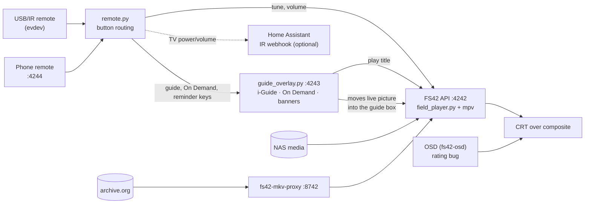

# T-ManTV feature guides

These pages explain how each T-ManTV feature works and how to set it up. The [main README](../../README.md) has the short list; [TMANTV-CHANGES.md](../../TMANTV-CHANGES.md) maps each change to the code that does it.

| Guide | What it covers |
|---|---|
| [Setup](setup.md) | Fresh Pi install, step by step, and what starts at boot |
| [Remote control](remote.md) | The USB/IR remote, the phone remote page, and what every button does |
| [i-Guide, reminders and the info banner](iguide-and-reminders.md) | The on-screen guide, scrolling ahead, setting reminders, the channel-change banner |
| [On Demand](ondemand.md) | The shows and movies menu, Continue Watching, and the nightly export |
| [Internet Archive streaming](archive-streaming.md) | `.strm` stubs, fast tuning, the local proxy, volume leveling and music beds |
| [On-screen extras](on-screen-extras.md) | Up Next card, rating bug, channel number, CRT picture size |
| [Scheduling and ads](scheduling.md) | Keeping the schedule filled, ad rotation, staying on the clock |
| [Commands and troubleshooting](commands.md) | The `fs42-*` helpers, logs, ports and common fixes |

## How the pieces fit together

- **`field_player.py`** is upstream FieldStation42's player, with T-ManTV changes. It plays the schedule through mpv and serves the API on port 4242.
- **`fs42_local/remote.py`** reads the remote and decides where each button goes: the player, the guide overlay, On Demand or a reminder pop-up.
- **`fs42_local/guide_overlay.py`** is one window that holds the i-Guide, the On Demand menu, the channel-change banner and reminder pop-ups. It stays hidden until needed, so it opens instantly.
- **`fs42_local/start_fs42.sh`** starts everything at boot and restarts any piece that exits.

## Ports

| Port | What |
|---|---|
| 4242 | FieldStation42 API and web pages (upstream) |
| 4243 | Guide overlay control API (local only) |
| 4244 | Phone remote page: `http://<pi>:4244/` |
| 8742 | archive.org index proxy (local only) |
| 3000 | Newspaper TV guide (optional) |
