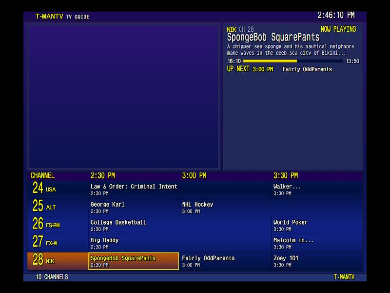
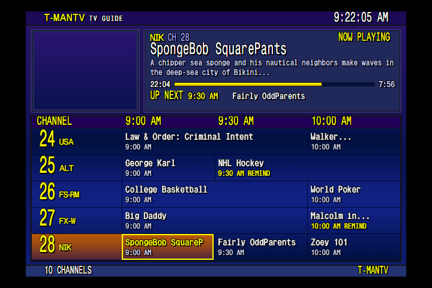
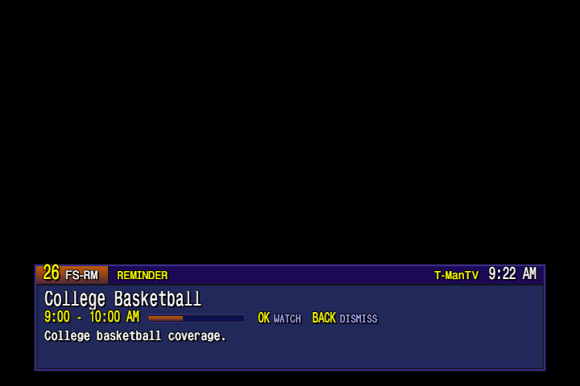
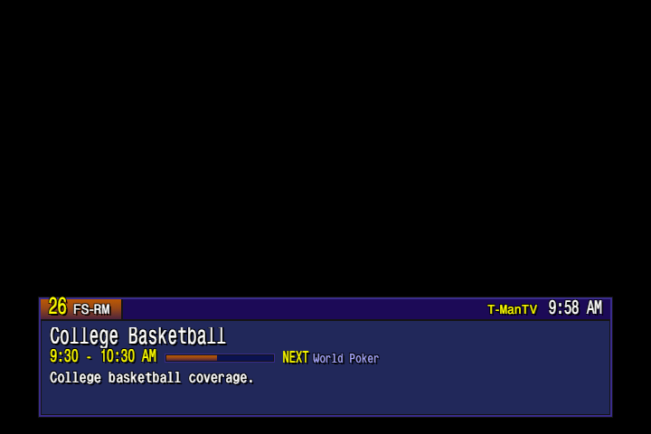

# i-Guide, reminders and the info banner

| Guide over the show | Reminders in the guide | Reminder pop-up | Info banner |
|---|---|---|---|
|  |  |  |  |

## The guide

Press **Guide** and a WeatherStar-style i-Guide covers the screen, with the show you were watching still playing in the top-right box. It's the same mpv player shrunk into that box, not a second copy, so it opens instantly and nothing restarts.

How it works: `guide_overlay.py` loads the guide page once at startup and keeps the window hidden. When you open it, it moves mpv's picture into the preview box (mpv video margins over `runtime/mpv.socket`) and cuts a hole in the window there with an X11 window shape. The hidden page reloads every 30 minutes so listings stay fresh.

- **Up / Down** move between channels, landing on the show that's on now.
- **Left / Right** move the grid 30 minutes per press. The next window is fetched ahead, so presses respond right away.
- **OK** on a show that's on now tunes to it. **Back** after that returns you to what you were watching.
- **Back** closes the guide. It also closes itself after 2 minutes idle.

The guide is based on the FieldStation42Expanded i-Guide. The T-ManTV look and the 30-minute scrolling are in `fs42/fs42_server/static/iguide/tmantv_skin.js` and `themes/ws.css`. The page options (theme, slots, description, header text) are in `GUIDE_URL` at the top of `guide_overlay.py`.

The skin is sized for a CRT over composite: four tall rows with big text, channel and show names on up to two lines, and the start time and plot in the info box. Music video channels show one row-wide **NOW PLAYING: Artist - Song (Year)** block from the music NFO, updated as each video starts.

If `guide_overlay.py` isn't running, Guide falls back to tuning channel 2, the full-screen i-Guide channel.

## Reminders

1. Open the guide and move ahead to a show that hasn't started yet.
2. Press **OK**. The show is marked **REMIND**. OK on it again clears it.
3. When it starts, if you're on another channel, a pop-up says it's on now.
4. **OK** tunes to it. **Back** dismisses it. Otherwise it goes away after 60 s.

Details:
- OK on a show starting within 30 s tunes to it instead of setting a reminder.
- If you're already on that channel, nothing pops up.
- If the guide or On Demand menu is open at start time, the pop-up waits until it closes. It's dropped if that's more than 10 minutes after the start.
- Reminders are removed once they fire. They're saved in `runtime/reminders.json`, so they survive a restart.

Timing settings (`REMINDER_SECS`, `REMINDER_LATE`, `REMINDER_AHEAD`) are at the top of `guide_overlay.py`.

## Channel-change info banner

After each tune, a WeatherStar-style bar at the bottom shows the channel, the show, its time slot, a progress bar and what's on next. It stays up 4 s (`BANNER_SECS` in `guide_overlay.py`). A reminder pop-up uses the same bar.

## Channel number

Separately from the banner, a big green channel number shows in the top-left on every button press, at startup and when the new video starts. Its style comes from the OSD settings in `pi/home/.config/mpv/mpv.conf`.
