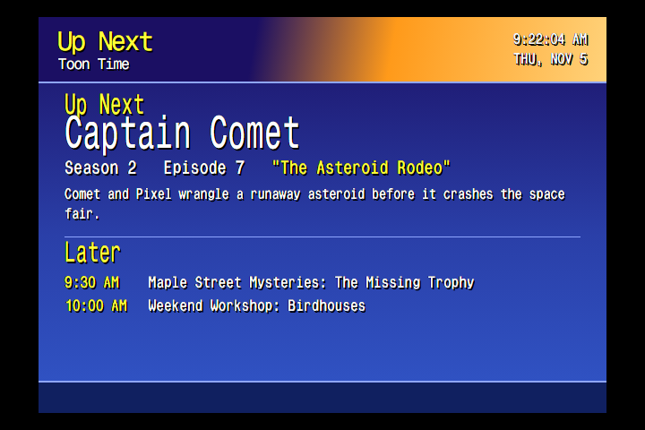

# On-screen extras

## Up Next card



On channels that turn it on, a WeatherStar-style card opens each block with the show and episode coming up, its plot, and the two after it.

Add `up_next` inside the station's `station_conf`. Every key is optional:

```json
"up_next": { "duration": 20, "header": "T-ManTV", "accent": "#ff9a1a", "ticker": "Stay tuned!", "music": "0" }
```

| Key | Meaning |
|---|---|
| `duration` | Card length in seconds (default 20) |
| `header` | Text under "Up Next" (default: the network name) |
| `accent` | Header color |
| `ticker` | Scrolling text at the bottom |
| `music` | `"0"` turns music off |

Music plays only if you put WeatherStar-style tracks in `fs42/fs42_server/static/upnext/music/` as `ws01.mp3` … `ws12.mp3`. They aren't in the repo.

The card also keeps streamed channels on time. If the last episode ran a little long while loading, that time comes out of the card, so the next episode still starts from the top. Rebuild the schedule after adding `up_next`.

The card is `fs42/fs42_server/static/upnext/upnext.html`.

## Rating bug

A rating icon (TV-Y7, TV-PG, PG-13...) shows in the top-right corner for 12 s when a show or movie starts and after commercial breaks. It never shows on ads, bumps or channel changes.

**Where the rating comes from:** `<mpaa>` or `<certification>` in the file's own `.nfo`. If a TV episode has none, it uses the nearest `tvshow.nfo` (the file's folder, up to 3 levels up), which also covers `.strm` stubs. Movies only use their own NFO. Ratings are saved when the catalog is built, so rebuild after adding them.

**Images:** `osd/ratings/<RATING>.png`. The repo includes G, PG, PG-13, R and TV-Y through TV-MA. Matching ignores case and drops `US:` and `Rated `. No rating or no image means no bug.

**Turn it on:** copy `osd/osd.json.example` to `osd/osd.json` if you don't have one, add this, and run `fs42-osd`:

```json
{ "type": "RatingDisplay", "directory": "osd/ratings", "halign": "RIGHT", "valign": "TOP",
  "width": 0.08, "height": 0.12, "x_margin": 0.22, "y_margin": 0.13, "display_time": 12.0 }
```

The margins keep it inside a CRT's overscan. Adjust them for your TV.

The rating overlay comes from MoeFwacky's FieldStation42 fork. T-ManTV added the `tvshow.nfo` fallback and keeps the image's shape.

## Channel number

A big green channel number shows top-left on every tune. See [i-Guide](iguide-and-reminders.md#channel-number).

## CRT picture size

CRTs hide the edges of the picture (overscan). Two settings handle that:

- **`tv-margins`** shrinks the composite output at the hardware level. `tv-margins L R T B` sets and saves the margins in pixels; plain `tv-margins` re-applies the saved ones (it runs at login). The defaults were tuned for one Magnavox set.
- **mpv shrink filter.** The `vf=` line in `mpv.conf` shrinks video a little. T-ManTV keeps that shrink, and a stub's `#crop`, active during channel-change static and other effects, where upstream would drop it.

Corner logos are turned off on T-ManTV.
