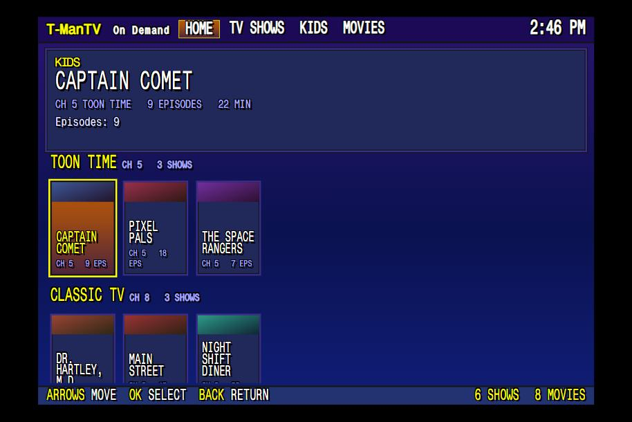
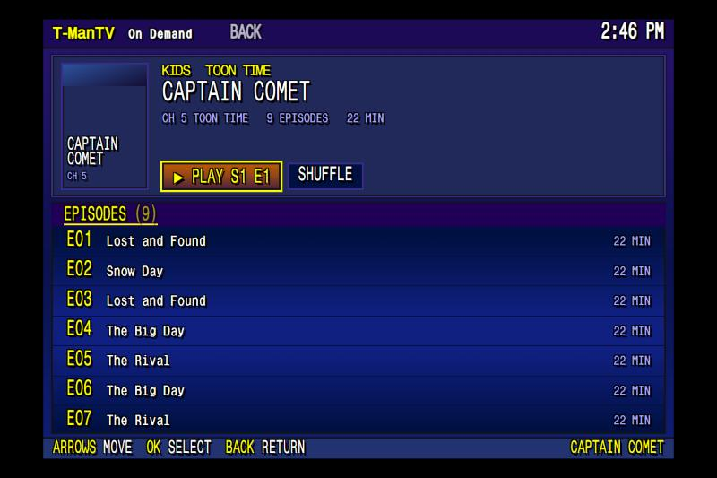

# On Demand

| Home | A show |
|---|---|
|  |  |

On Demand is a menu of every show and movie in your catalog. Pick any episode or movie and it plays right away, full screen, outside the channel schedule.

## Using it

- Open it with the **On Demand** button, or dial **99**.
- Tabs: **Home**, **TV Shows**, **Kids** and **Movies**. TV Shows and Kids can be filtered by channel. Movies are grouped by decade.
- **Continue Watching** on Home lists anything you stopped between 2 minutes in and 95% through.
- A show's page has a **Resume** button for the episode you stopped in, or **Next** for the episode after the last one you finished, plus every season and episode with plots and air dates.
- While a title plays: **OK** pauses, **Left** goes back 10 s, **Right** skips 30 s, **Back** returns to the menu. Channel buttons leave On Demand and tune as normal.

Live TV keeps running muted under the menu, so leaving On Demand drops you back on the channel you were watching. The menu closes itself after 5 minutes idle.

## How it works

1. **Menu data.** `pi/home/ondemand_export.py` builds `fs42/fs42_server/static/ondemand/catalog.json` every night at 4:50 (cron). It walks `catalog/` and fills in runtimes, titles, plots and season/episode numbers from FieldStation42's own database (`runtime/fs42_fluid.db`). It doesn't read NFOs or probe files on the NAS, so it's fast, and `.strm` stubs get runtimes too.
2. **Channels.** The export reads your `confs/*.json`, so new or renumbered channels show up on the next run. A station whose name starts with `Movies ` becomes a movie decade.
3. **Menu.** `static/ondemand/ondemand.html` and `ondemand.js` draw the menu inside the guide overlay window.
4. **Playback.** OK on a title sends an `ondemand` command to `runtime/channel.socket`, and `field_player.py` plays it (`play_ondemand` in `station_player.py`).
5. **Watch positions** are saved to `runtime/ondemand_positions.json`.

## Running the export by hand

After adding shows or rebuilding the catalog:

```bash
cd ~/FieldStation42
env/bin/python3 ~/ondemand_export.py fs42/fs42_server/static/ondemand/catalog.json --paths
```

`--paths` is required for the real menu (it stores the file path each title plays from).

## Customizing

These are set near the top of the files:

| Setting | File | Meaning |
|---|---|---|
| `SKIP_STATIONS` | `ondemand_export.py` | Catalog folders left out of the menu (news, music, guide...) |
| `KIDS_STATIONS` | `ondemand_export.py` | Channels listed under Kids. Everything else goes under TV Shows. |
| `SHORT_NAMES` | `ondemand_export.py` | Shorter channel labels for the menu |
| `SKIP_TAGS` | `ondemand_export.py` | Tag folders never listed (bumps, commercials, sign-on/off...) |
| `RENAME` | `ondemand.js` | Show display names |

A station with `"hidden": true` in its `station_conf` is also left out.
